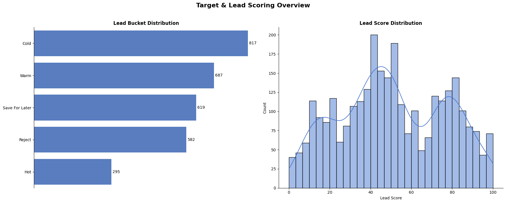
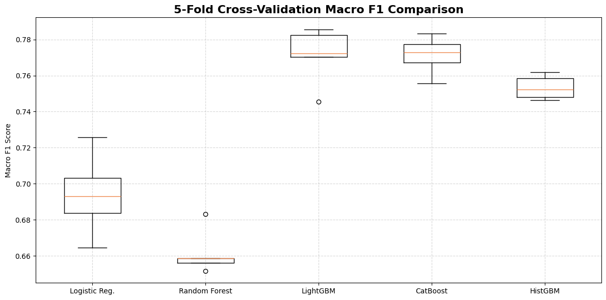
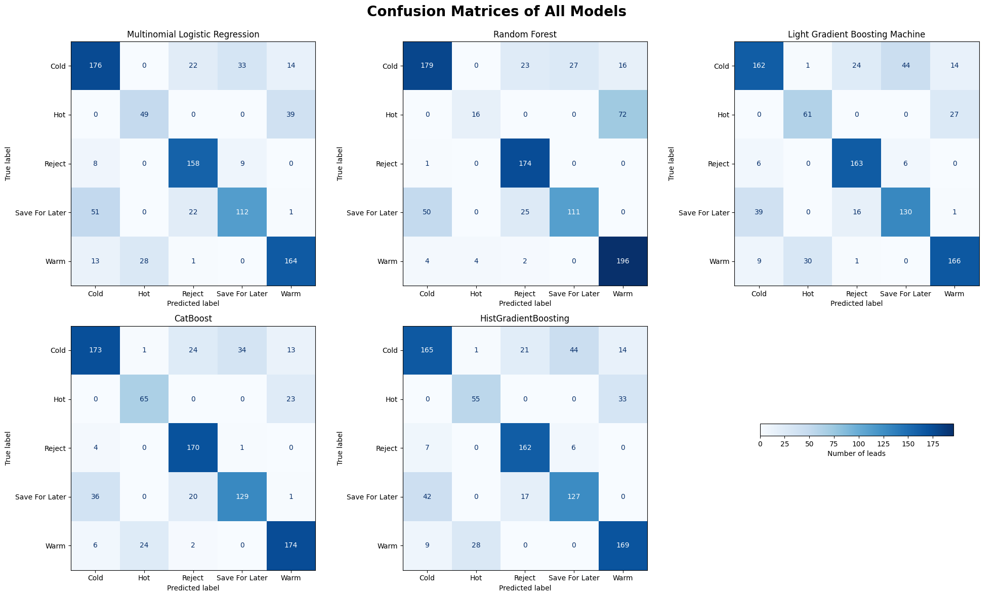
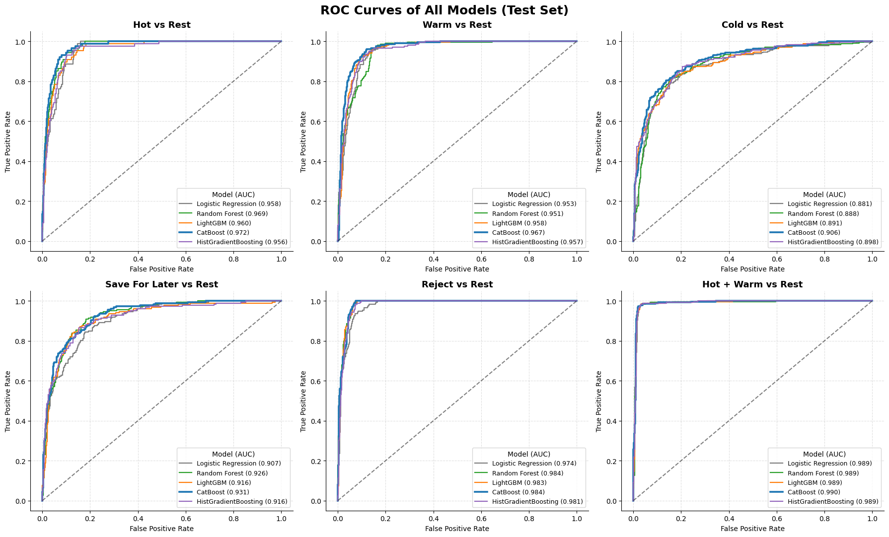
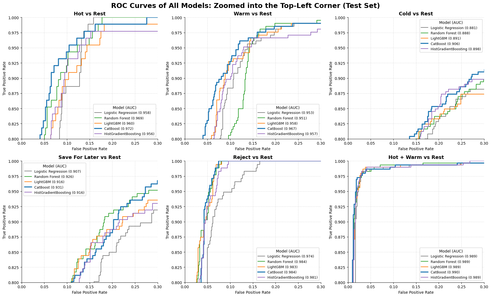
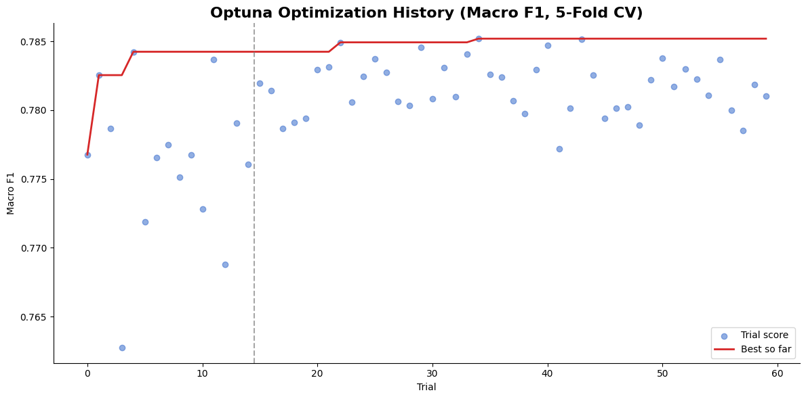
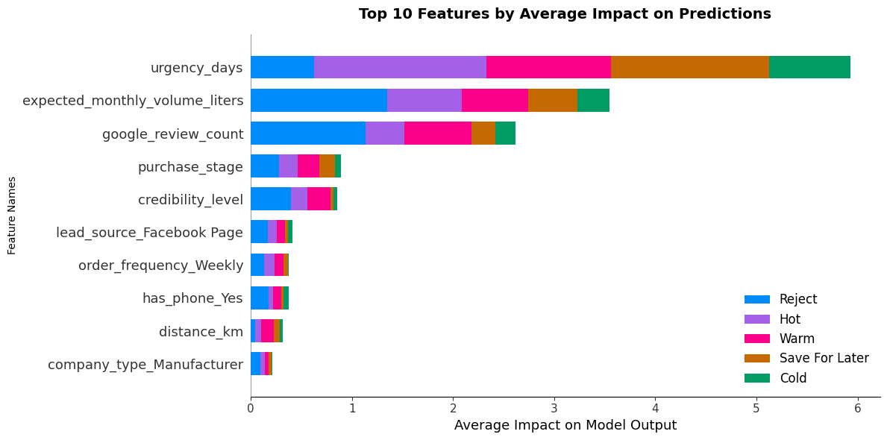
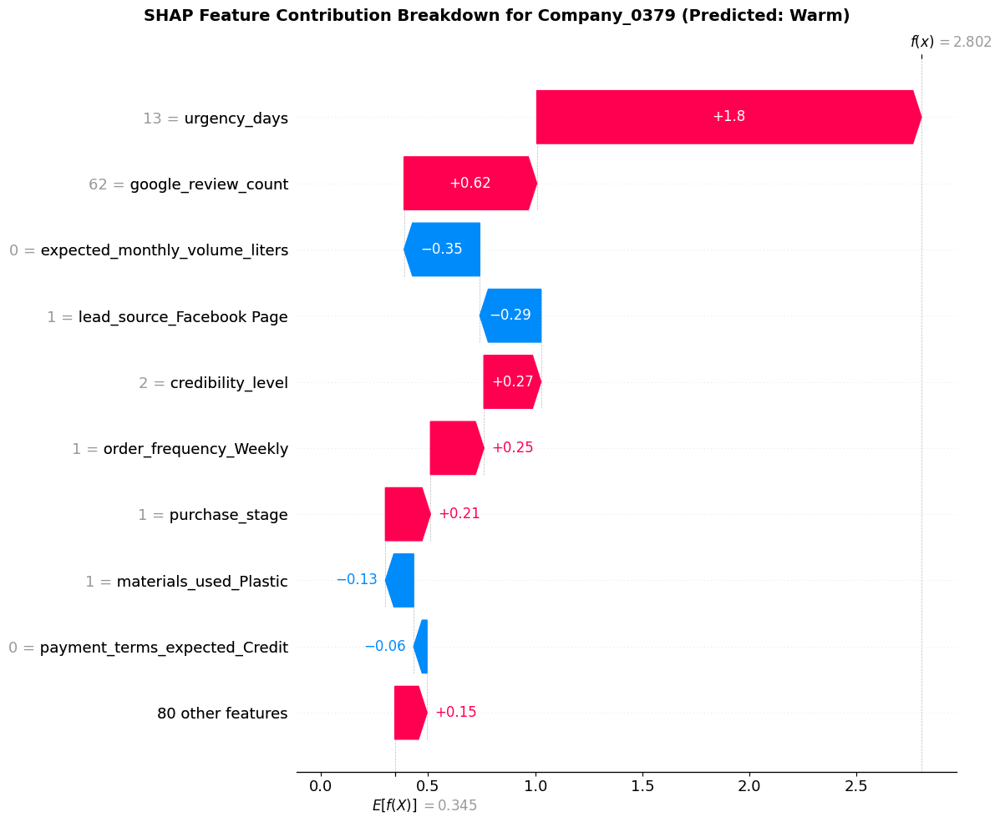

<div style="text-align: justify;">

# Lead Evaluator for Swan Chemicals Ltd.

## Executive Summary

This project develops a **Lead Evaluator** system for **Swan Chemical Ltd.** to support faster and more consistent sales prioritization in the adhesives business. The model predicts a lead's **bucket**—Hot, Warm, Cold, Save For Later, or Reject—based on operational feasibility, commercial potential, and credibility signals. In addition to the bucket prediction, the system produces a probability-based **lead score** (**QualifiedScore = P(Hot) + P(Warm)**) and maps it to simple actions (**Prioritize**/**Nurture**/**Deprioritize**) for practical business use. The project is built on a **synthetic dataset** of 3,000 leads, so it is a proof-of-concept (MVP) rather than a validated production system.

Five multi-class models were trained and compared: **Multinomial Logistic Regression**, **Random Forest**, **LightGBM**, **HistGradientBoosting**, and **CatBoost**. They were evaluated with multi-class-appropriate metrics such as **Macro F1**, cross-validation stability, and ROC-AUC (OVR and Qualified-vs-Not), with all preprocessing learned inside each cross-validation fold to avoid leakage. **CatBoost** was selected as the final model and tuned with **Optuna**, which sharply reduced its overfitting.

**The tuned CatBoost model achieved:**

* **Macro F1 (Test):** 78.72%
* **OVR Macro AUC:** 95.55% and **Qualified-vs-Not AUC:** 99.08%
* **Cross-Validation Macro F1 (new folds):** 0.7754 ± 0.0143
* **Overfitting:** Train–Test Macro F1 gap reduced from **21.61%** to **7.41%** after tuning, which falls in the "Good" range.

Explainability was supported through **feature importance** and **SHAP** analysis, showing that the model is primarily driven by high-signal business variables such as **urgency**, **expected monthly volume**, and **Google review count**, aligning well with real-world sales logic. The model is strongly **urgency-led**, so accurate urgency data matters (see [Limitations](#limitations--next-steps)).

***A video presentation explaining the project can be found [here](https://www.linkedin.com/posts/tasnimtalha09_i-built-a-%F0%9D%97%BA%F0%9D%97%AE%F0%9D%97%B0%F0%9D%97%B5%F0%9D%97%B6%F0%9D%97%BB%F0%9D%97%B2-%F0%9D%97%B9%F0%9D%97%B2%F0%9D%97%AE%F0%9D%97%BF%F0%9D%97%BB%F0%9D%97%B6%F0%9D%97%BB%F0%9D%97%B4-activity-7444948862731186176-6_kt?utm_source=social_share_send&utm_medium=member_desktop_web&rcm=ACoAADzHX0oB0t4dpMRgmmkbZZhC5z3UQS7rZrw).***


## Business Problem

Sales teams often receive numerous inquiries, but not all leads are worth the equal effort. Some companies are genuinely high-potential buyers, while others are low-volume, unready, unreachable, or unreliable. Spending time on poor-fit leads increases cost and delays follow-up on qualified opportunities.

The core business question addressed in this project is:

> ***Can we predict whether an incoming company inquiry is a high-potential lead and prioritize it using measurable lead characteristics?***

A reliable lead evaluation system helps Swan Chemical Ltd.:
* Focus sales effort on the highest-value opportunities
* Reduce time wasted on low-quality or non-serviceable leads
* Standardize lead assessment to reduce human subjectivity
* Improve response speed and customer experience through quicker triage


## Repository Structure

```text
lead-evaluator/
├── artifacts/                # saved pipeline and metadata used by the scoring script
├── assets/                   # figures used in this README
├── datasets/                 # lead data (training data and test leads to score)
├── docs/                     # documentation for the lead evaluation system
├── notebooks/
│   └── lead_evaluator.ipynb  # development notebook: EDA, training, tuning, explainability
├── src/
│   ├── pipeline.py           # loads the saved pipeline, checks inputs, scores leads
│   └── score_new_leads.py    # command-line script: CSV in, scored leads out
├── requirements.txt
└── README.md
```


## Methodology

### Data Preparation

The dataset is **synthetic** and was designed to simulate the information a real sales team can collect at the lead stage. It contains **3,000 leads** and 25 columns. Three columns are not used as model inputs: `company_name` (an identifier), `lead_bucket` (the target), and `lead_score` (dropped to prevent leakage). That leaves **22 input features**: operational variables (distance, urgency), commercial variables (expected demand, order frequency), and credibility/intent signals (purchase stage, credibility level, online presence).


***Figure 01:** Distribution of the five lead buckets and of the lead score.*

The classes are moderately imbalanced: Cold (817), Warm (687), Save For Later (619), Reject (582), and Hot (295), which is why **Macro F1** is the primary metric. The data was split **70/30** (2,100 training and 900 test leads), stratified by bucket, with a fixed random seed. The test set holds 88 Hot leads.

> **Data note:** 12.7% of leads (382 of 3,000) have both `expected_monthly_volume_liters = 0` and `google_review_count = 0`. This most likely means *volume not provided* rather than a true zero, so the model treats it as its own group.

#### Preprocessing Pipeline

All preprocessing is wrapped in a scikit-learn **`ColumnTransformer`** and chained with each model in a **`Pipeline`**:
1. **Ordinal variables** (where order matters) are encoded with **Ordinal Encoding** using a fixed category order: `employee_estimate`, `credibility_level`, and `purchase_stage`.
2. **Nominal categorical variables** are encoded with **One-Hot Encoding** (first category dropped, unseen categories ignored).
3. **Numeric variables** are standardized with **StandardScaler**, but only for Logistic Regression, since tree-based models are unaffected by feature scale.
4. Every step is learned from the **training data only**, and during cross-validation it is **re-learned inside each fold**, so no information from a validation fold leaks into the preprocessing. The 22 input features become **89** model features after encoding.

### Model Training & Performance Evaluation

We trained and compared **five** multi-class classification models, each with hand-set (untuned) baseline parameters:
1. Multinomial Logistic Regression
2. Random Forest Classifier
3. LightGBM Classifier
4. HistGradientBoosting Classifier and
5. CatBoost Classifier

All models were evaluated using:
* Accuracy
* Precision, Recall and F1-score (per class)
* Macro F1 **(primary metric)** and Weighted F1
* OVR ROC-AUC **(Macro and Weighted)**
* Qualified-vs-Not ROC-AUC **(Hot/Warm vs others)**
* Overfitting check **(Train–Test Macro F1 gap)**
* 5-Fold Stratified Cross-Validation **(Macro F1)**
* **Hot/Warm Exact Recall** (share of Hot and Warm leads placed in their exact bucket) and **Qualified Recall** (share of Hot and Warm leads predicted as Hot *or* Warm, which is the question the business actually asks)


### Model Selection & Validation Strategy

Because this is a **multi-class** and **business-prioritization** problem, the selection emphasized metrics that reflect balanced class performance and generalization:

1. **Macro F1 as the primary metric** (prevents the model from ignoring minority classes like Hot)
2. **Cross-validation stability** to ensure reliability across different splits; **models are ranked by cross-validated Macro F1**, with test results reported for reference
3. **Overfitting checks** using the Train–Test Macro F1 gap
4. **AUC-based ranking quality**, especially for "Qualified vs Not Qualified" triage

#### Model Comparison Summary
A summary of the performance of the **five** models is presented below:

***Table 01:** All Model Performance Summary (ranked by cross-validated Macro F1; best value in each column in bold).*
| **Rank** | **Model** | **Macro F1** | **Weighted F1** | **Accuracy** | **Train–Test Gap** | **CV Mean F1** | **CV Std** | **OVR Macro AUC** | **OVR Weighted AUC** | **Qual-vs-Not AUC** | **Hot/Warm Exact Recall** | **Qualified Recall** |
|:---:|:---|:---:|:---:|:---:|:---:|:---:|:---:|:---:|:---:|:---:|:---:|:---:|
| 1 | CatBoost | **78.35%** | **78.68%** | **79.00%** | 21.61% | **0.7713** | 0.0095 | **95.19%** | **94.66%** | **99.03%** | **81.29%** | 97.28% |
| 2 | LightGBM | 75.06% | 75.52% | 75.78% | 24.94% | 0.7712 | 0.0141 | 94.17% | 93.62% | 98.89% | 77.21% | 96.60% |
| 3 | HistGradientBoosting | 74.19% | 75.04% | 75.33% | 25.81% | 0.7534 | **0.0059** | 94.15% | 93.69% | 98.94% | 76.19% | 96.94% |
| 4 | Logistic Regression | 71.53% | 72.82% | 73.22% | **7.97%** | 0.6941 | 0.0203 | 93.46% | 92.84% | 98.87% | 72.45% | 95.24% |
| 5 | Random Forest | 68.02% | 72.67% | 75.11% | 9.61% | 0.6617 | 0.0110 | 94.36% | 93.69% | 98.86% | 72.11% | **97.96%** |



***Figure 02:** 5-fold cross-validated Macro F1 for each model.*

**Key observations:**
* **CatBoost** ranks first on Macro F1, weighted F1, accuracy, every AUC, and exact recall. On cross-validation it is **tied with LightGBM** on the mean (0.7713 vs 0.7712), so CV alone does not separate the two. CatBoost is preferred because of its **lower fold-to-fold spread** (0.0095 vs 0.0141), its higher worst fold, and its stronger test results.
* **Boosting beats Logistic Regression and Random Forest** by a wide margin (roughly 6 to 11 points of CV Macro F1), much larger than the fold-to-fold spread.
* All three boosters **overfit heavily** (Train–Test gaps of 21.61% to 25.81%, with training Macro F1 close to 100%). Logistic Regression and Random Forest have smaller gaps only because they have lower capacity, and their scores are lower. The large CatBoost gap is the reason for the tuning stage that follows.
* All five models separate **qualified (Hot/Warm) from non-qualified leads almost perfectly** (Qualified-vs-Not AUC 98.86% to 99.03%). The real difference between models is in telling **Hot from Warm** and in the finer buckets.


***Figure 03:** Confusion matrices of all five models on the test set (shared color scale).*

* **Errors concentrate in two places:** Hot ↔ Warm, and Cold ↔ Save For Later (the largest source of errors for every model). No model ever predicts a Hot lead as Cold, Reject or Save For Later, and Reject is the cleanest class (recall 90% to 99%).
* **CatBoost** finds the most Hot leads (65 of 88) and sends only 8 of 294 qualified leads into a non-qualified bucket. **Random Forest** sends 72 of 88 Hot leads to Warm (Hot recall 18%), which explains its low Macro F1 despite decent accuracy.


***Figure 04:** One-vs-Rest ROC curves per bucket, plus Hot + Warm vs Rest (test set).*

Since the above combined ROC AUC plots are difficult to read, we will also generate a **zoomed-in version** of the same plot to better visualize the differences between the models.


***Figure 05:** One-vs-Rest ROC curves per bucket, plus Hot + Warm vs Rest, zoomed into the top-left corner (test set).*

* **CatBoost has the highest AUC in every panel** (tied with Random Forest on Reject), but its edge over the runner-up is under one point.
* **Cold** and **Save For Later** are the hardest buckets to rank for every model, and **Hot + Warm vs Rest** is near-perfect for all five (AUC 0.989 to 0.990).


## Final Model Tuning & Selection

**CatBoost** was tuned with **Optuna** using its **TPE (Tree-structured Parzen Estimator)** sampler, which learns from earlier trials instead of sampling blindly. The search ran **60 trials** (the first 15 random), and each trial was scored as the mean Macro F1 over the same **5 stratified folds** of the training set.

**Search space:** `iterations` (300 to 1,200), `learning_rate` (0.01 to 0.1, log scale), `depth` (3 to 6), `l2_leaf_reg` (1 to 30, log scale), `subsample` (0.5 to 1.0), `rsm` (0.4 to 1.0), `random_strength` (0.1 to 10, log scale), and `auto_class_weights` (None, SqrtBalanced or Balanced). Bernoulli bootstrap and `border_count = 128` were fixed.

**Design choices to keep the evaluation honest:**
* A fresh pipeline is fitted inside every fold, so preprocessing never sees the validation fold.
* No early stopping, because it would reuse the validation fold for both stopping and scoring.
* Class weighting was treated as a tuned parameter, so it was decided by cross-validation and not by test results.
* The **test set was not used in the search**. It was used afterwards to evaluate the final model.


***Figure 06:** Macro F1 of each Optuna trial; the line shows the best score so far and the dashed line marks the end of the random phase.*

### Best Parameters (Optuna TPE)

The final tuned model used the following best parameters (**best trial: 34 of 60**):

* `iterations = 900`
* `learning_rate = 0.024`
* `depth = 4`
* `l2_leaf_reg = 1.23`
* `subsample = 0.65`
* `rsm = 0.59`
* `random_strength = 3.32`
* `auto_class_weights = None`

#### Key Takeaways

* The best cross-validation Macro F1 during the search was **0.7852**. This is the maximum of 60 noisy trials, so it is slightly optimistic. Re-scoring both models on a **different set of folds** gives **0.7754** for the tuned model against **0.7714** for the baseline.
* The gain in score is **small** (+0.37 points of test Macro F1, +0.004 in CV), within the fold-to-fold spread. **The real benefit of tuning is lower overfitting**: the Train–Test gap fell from 21.61% to 7.41%.
* Cross-validation chose **no class weighting** (`auto_class_weights = None`).

***Table 02:** Base vs Tuned CatBoost.*
| **Metric** | **Base CatBoost** | **Tuned CatBoost** |
|------------|:---:|:---:|
| Macro F1 (Test) | 78.35% | 78.72% |
| Train–Test Macro F1 Gap | 21.61% | 7.41% |
| CV Macro F1 on new folds (Mean) | 0.7714 | 0.7754 |
| CV Macro F1 on new folds (Std) | 0.0169 | 0.0143 |

### Model Performance

***Table 03:** Tuned CatBoost Model Performance Summary.*
| **Metric** | **Test/CV Performance** |
|------------|----------------------------|
| ***Macro F1 (Test)*** | **78.72%** |
| ***Macro F1 (Train)*** | **86.13%** |
| ***Overall Accuracy (Test)*** | **79.22%** |
| ***Cross-Validation Macro F1 (New Folds, Mean ± Std)*** | **0.7754 ± 0.0143** |
| ***OVR ROC-AUC (Macro)*** | **95.55%** |
| ***OVR ROC-AUC (Weighted)*** | **95.04%** |
| ***Qualified-vs-Not ROC-AUC*** | **99.08%** |
| ***Hot Recall (Test)*** | **76%** |
| ***Warm Recall (Test)*** | **85%** |
| ***Train–Test Macro F1 Difference (Overfitting*)*** | **7.41%** |
| ***Overfitting Status*** | **Good** |
| ***Best Tuned Parameters (Optuna TPE)*** | `iterations = 900`, `learning_rate = 0.024`, `depth = 4`, `l2_leaf_reg = 1.23`, `subsample = 0.65`, `rsm = 0.59`, `random_strength = 3.32`, `auto_class_weights = None` |

***Overfitting criteria (based on Train–Test Macro F1 gap):** Good (<10%), Moderate (10–20%), High (>20%)

***Table 04:** Tuned CatBoost per-class performance (test set, 900 leads).*
| **Bucket** | **Precision** | **Recall** | **F1-score** | **Support** |
|:---|:---:|:---:|:---:|:---:|
| Cold | 0.78 | 0.71 | 0.74 | 245 |
| Hot | 0.74 | 0.76 | 0.75 | 88 |
| Reject | 0.79 | 0.98 | 0.87 | 175 |
| Save For Later | 0.78 | 0.67 | 0.72 | 186 |
| Warm | 0.85 | 0.85 | 0.85 | 206 |

#### Key Insights

* The tuned CatBoost model performs well across all five buckets. **Reject** (F1 0.87) and **Warm** (0.85) are the strongest, while **Cold** (0.74) and **Save For Later** (0.72) are the weakest.
* Overfitting is now in the **Good** range (7.41% gap), although the model still fits the training data better than new data (86.13% vs 78.72%).
* High AUC values confirm strong ranking ability, especially for the core business triage decision: identifying qualified opportunities (Hot/Warm) at **99.08%**.

### Top Features

**Methodology:** Both **SHAP (Shapley Additive exPlanations)** values and **native CatBoost feature importance** were used to identify the key lead drivers, through importance scores, a SHAP bar chart, and a SHAP waterfall for an individual lead.


***Figure 07:** Across the entire dataset, which features matter the most on average?*


***Figure 08:** For one specific company, why did the model predict a particular value?*

#### Key Findings
Across the three explanation lenses—**CatBoost's built-in importance**, **SHAP average impact (global)**, and a **SHAP waterfall (individual case)**—the same story emerges: **lead urgency drives prioritization**, **expected demand and business footprint add commercial value**, and **credibility and intent signals refine decisions rather than override the core drivers.**

* **Urgency is the dominant driver:** `urgency_days` ranks first in both CatBoost importance (**34.8%**) and SHAP impact. In the waterfall example (Company_0379, predicted Warm), a need within **13 days** supplies about three-quarters of the lead's rise towards Warm (**+1.8**).

* **Volume and reviews form the second tier:** `expected_monthly_volume_liters` (**20.8%**) and `google_review_count` (**15.4%**) join urgency to make up about **71%** of the total importance. In SHAP they act mostly on the **Reject** bucket. In the waterfall, **62 reviews** add **+0.62** to the Warm score, while a volume recorded as **0 liters** (not provided) subtracts **0.35**.

* **Buying intent and trust nudge decisions:** `credibility_level` (**4.1%**) and `purchase_stage` (**2.8%**) take fourth and fifth place in both methods (their order swaps between them), with far smaller impact than the top three.

* **Operational and contactability features make small adjustments:** `distance_km`, `has_phone_Yes`, `order_frequency_Weekly` and the lead source each hold only about **1–2%** of the importance, acting as tie-breakers rather than drivers.

**Key Takeaway:**
Lead qualification in this model is **urgency-led** and **value-shaped**. Credibility and intent signals add smaller nudges, while operational factors fine-tune decisions without driving them. This dependence is strong: in a separate ablation run, removing `urgency_days` lowered the cross-validated Macro F1 from **0.785** to **0.600**, so the model's quality relies on urgency being recorded accurately for every lead.


## Model Deployment & Testing

The development notebook serves as the environment for cleaning, training, evaluation, and tuning. For business-side usage, the model is deployed through a saved pipeline and two lightweight scripts:

1.  The **entire tuned pipeline** (preprocessing and the CatBoost model in one object) is saved as `lead_evaluator_pipeline.joblib` in the [**`artifacts`**](./artifacts/) folder, together with a small `metadata.joblib` (input columns, categories and numeric ranges seen in training, and the score thresholds). Saving one object guarantees that new leads are encoded exactly like the training data, with no hand-copied preprocessing steps.
2.  A production module [**`pipeline.py`**](./src/pipeline.py) loads these artifacts, **checks every incoming lead**, and exposes a clean `predict_leads()` function.
3.  A runner script [**`score_new_leads.py`**](./src/score_new_leads.py) reads a CSV of new leads and outputs:
    * Predicted lead bucket
    * Probability-based lead score (QualifiedScore, 0 to 100)
    * Recommended action: **Prioritize (Sales)** at a score of 70 or more, **Nurture (Follow-up)** from 40 to 69, and **Deprioritize** below 40
    * A **Data Flag** column explaining any issue found with the lead

This separation allows real usage without exposing training code.

### Input Checks

CatBoost reads a missing number as the *smallest* value, so a lead with no `urgency_days` would otherwise look like the most urgent lead of all. To avoid silent mistakes, every lead is checked before scoring:

| **Problem found** | **What happens** |
|:---|:---|
| A missing value in any input column | **Not scored**, marked "Check data first" |
| A negative number in a numeric column | **Not scored**, marked "Check data first" |
| A number outside the range seen in training | Scored, but **flagged** |
| A category never seen in training | Scored, but **flagged** |
| `expected_monthly_volume_liters = 0` | Scored, but **flagged** as "volume not provided" |

Yes/No columns (`has_phone`, `has_google_listing`) are accepted as Yes/No, True/False, or 1/0.

### Input File Format

The CSV must contain `company_name` plus the **22 model inputs**: `industry_category`, `sub_industry`, `location_area`, `district`, `zone_type`, `distance_km`, `company_type`, `employee_estimate`, `materials_used`, `adhesive_type_needed`, `product_needed`, `application_type`, `purchase_stage`, `expected_monthly_volume_liters`, `order_frequency`, `urgency_days`, `payment_terms_expected`, `has_google_listing`, `google_review_count`, `has_phone`, `credibility_level`, and `lead_source`. If the file also contains `lead_bucket` and `lead_score`, the script additionally reports a Match/Mismatch status and the bucket accuracy, which is useful for testing.


## Limitations & Next Steps

* **Synthetic data:** the results show that the pipeline works, not how the model would perform on real leads. It should be re-validated once real lead outcomes are available.
* **Heavy reliance on urgency:** the model leans strongly on `urgency_days`, so missing or inaccurate urgency values would degrade the results. The input checks above guard against missing values, not against wrong ones.
* **Small gains from tuning:** the improvement in score was within noise. The main benefit was reduced overfitting, and a train–test gap of 7.41% still remains.
* **Uncalibrated actions:** the 70/40 score thresholds for Prioritize/Nurture/Deprioritize are a starting point and should be recalibrated against real sales outcomes.
* **Zero volume:** leads with `expected_monthly_volume_liters = 0` are scored as low-volume leads, which may undervalue buyers who simply did not state their volume.
* **Test-set size:** the test set has only 88 Hot leads, so Hot-specific metrics can move noticeably with a different split.


## How to Replicate / Use

Follow these steps to run the lead scorer on your own machine. The commands below are for **macOS or Linux**, and the Windows equivalents are noted where they differ.

### Step 1: Clone the repository

```bash
git clone https://github.com/tasnimtalha09/lead-evaluator.git
cd lead-evaluator
```

### Step 2: Install Python 3.14 and create a virtual environment

First check whether Python 3.14 is already installed:

```bash
python3.14 --version
```

If you see `Python 3.14.x`, skip to the "Create the virtual environment" step. If the command is not found, install it:

* **macOS (Homebrew):** `brew install python@3.14`
* **macOS/Windows (installer):** download Python 3.14 from [python.org/downloads](https://www.python.org/downloads/) and run the installer. On Windows, tick **"Add python.exe to PATH"** and then use `py -3.14` in place of `python3.14`.
* **Linux:** use your package manager if it offers Python 3.14, or install it with [pyenv](https://github.com/pyenv/pyenv) (`pyenv install 3.14` followed by `pyenv local 3.14`).

Then create and activate the virtual environment:

```bash
# creating the virtual environment inside the project folder
python3.14 -m venv .venv

# activating it (Windows: .venv\Scripts\activate)
source .venv/bin/activate

# confirming that the environment uses Python 3.14
python --version
```

Your terminal prompt should now start with `(.venv)`. To leave the environment later, run `deactivate`.

### Step 3: Install the dependencies

```bash
pip install --upgrade pip
pip install -r requirements.txt
```

> **Important:** the saved pipeline was created with **scikit-learn 1.8.0** and **CatBoost 1.2.10**. `requirements.txt` pins these versions, and a different version may fail to load the saved pipeline.

### Step 4: Score the leads

With the environment active, run the scoring script on a CSV of leads:

```bash
python src/score_new_leads.py datasets/leads_test.csv
```

To also save the scored results to a CSV file:

```bash
python src/score_new_leads.py datasets/leads_test.csv --out scored_leads.csv
```

The script prints one row per lead with the predicted bucket, the lead score (0 to 100), the recommended action, and a data flag. To score your own leads, replace `datasets/leads_test.csv` with the path to your file (see [Input File Format](#input-file-format)).

### Optional: Re-run the notebook

To retrain the models, open `notebooks/lead_evaluator.ipynb` in Jupyter or VS Code and select the `.venv` environment as the kernel. Run all cells from top to bottom. The Optuna search takes a few minutes, and the last cells save a fresh pipeline into `artifacts/`.

### Troubleshooting

* **`python3.14: command not found`:** Python 3.14 is not installed or not on your PATH; repeat Step 2.
* **`No such file or directory: artifacts/lead_evaluator_pipeline.joblib`:** the artifacts are missing. Re-run the final cells of the notebook to create them.
* **A scikit-learn or CatBoost version error when loading the pipeline:** the installed versions do not match `requirements.txt`; reinstall with `pip install -r requirements.txt`.
* **`Input is missing required column(s)`:** the CSV lacks one of the required columns listed in [Input File Format](#input-file-format).


## Conclusion

This project delivered a practical MVP that transforms lead information into clear, business-ready outputs. The tuned CatBoost model provides strong multi-class performance (Macro F1 of 78.72%), much lower overfitting after tuning (a 7.41% gap, down from 21.61%), and excellent separation of qualified from non-qualified leads (AUC of 99.08%). Combined with a probability-based lead score, an action rule, and input checks that stop bad data from being scored, the system is suitable for lead triage in a proof-of-concept setting. Because the data is synthetic and the model depends heavily on urgency, the next step is to validate and recalibrate it as Swan Chemical Ltd. accumulates real lead outcomes and feedback.

</div>